<h1 align="center">AI Engineer Coach</h1>

<p align="center">
<strong>Understand your codebase and how AI changed it.</strong><br>
An Archify knowledge graph, AI edit history with diffs, and coaching analytics for Claude Code, Codex, Copilot and more.
</p>

<p align="center">
<a href="LICENSE"></a>

</p>

<p align="center">
<sub>A personal fork of <a href="https://github.com/microsoft/AI-Engineering-Coach">microsoft/AI-Engineering-Coach</a> — see <a href="#credits--attribution">Credits &amp; Attribution</a>.</sub>
</p>

<br>

<p align="center">
  
https://github.com/user-attachments/assets/9f0239bf-20e0-459f-b137-17cce0edd1b2

</p>

---

## What it does

AI Engineer Coach reads your local AI session logs and turns them into actionable insights — no data leaves your machine.

- **Understand your codebase** -- **Atlas** generates a source-linked architecture map of the open workspace with the [Archify](https://github.com/tt-a1i/archify) skill; click any reference to jump to the file and line
- **Understand what AI changed** -- **Replay** is git blame for AI: for any file, every session and prompt that edited it, with per-turn diffs reconstructed from your local Claude Code transcripts
- **Track progress** -- practice scores, weekly trends, daily activity charts
- **Detect anti-patterns** -- 45 rules across prompt quality, session hygiene, code review, tool mastery, and context management
- **Measure output** -- AI-generated code volume by language, workspace, model, and harness
- **Discover skills** -- find repeated prompts and turn them into reusable skills
- **Score context health** — agentic readiness checks, instruction-file audits, workspace context maps

<details>
<summary><strong>Screenshots</strong></summary>
<br>
<p align="center">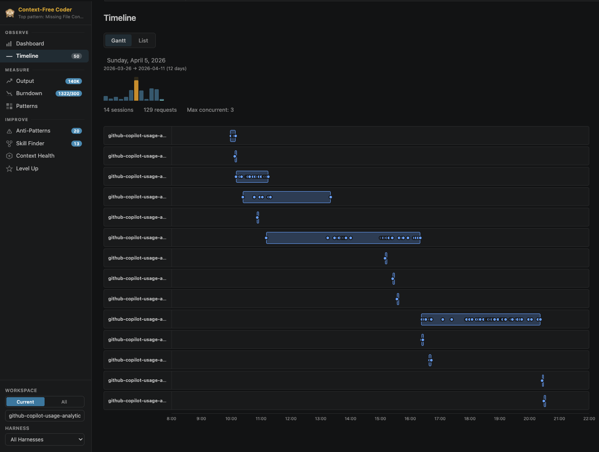</p>
<p align="center">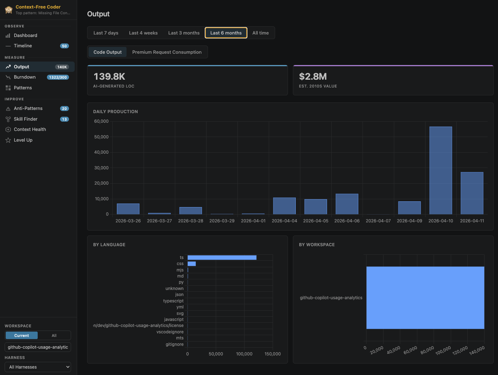</p>
<p align="center">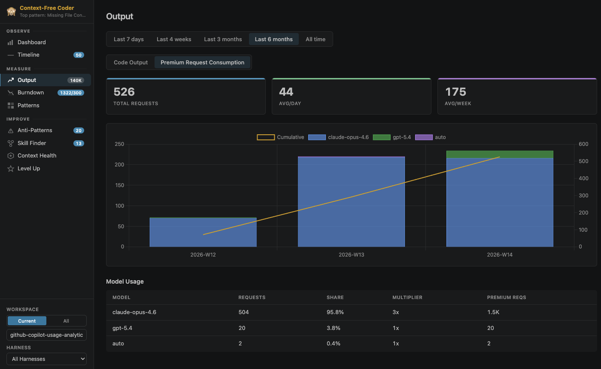</p>
<p align="center">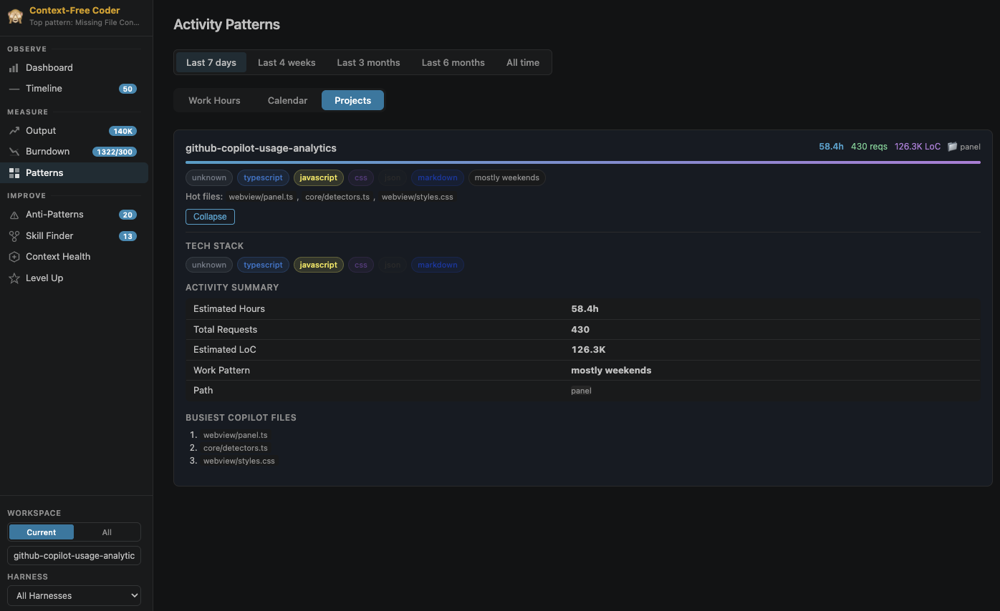</p>
<p align="center">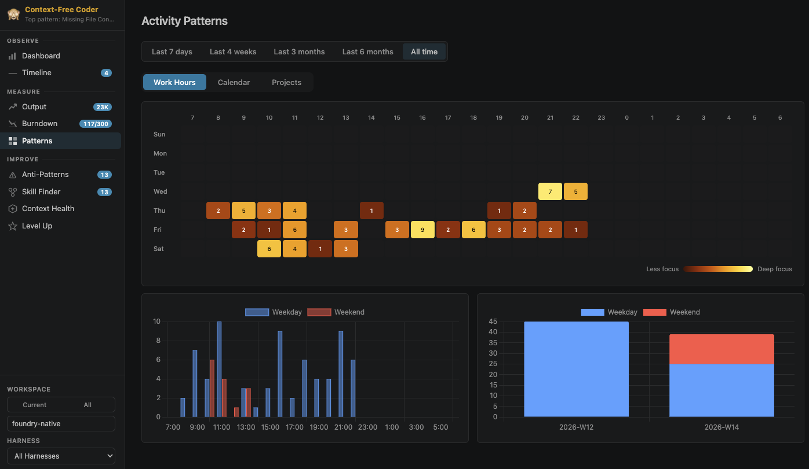</p>
<p align="center">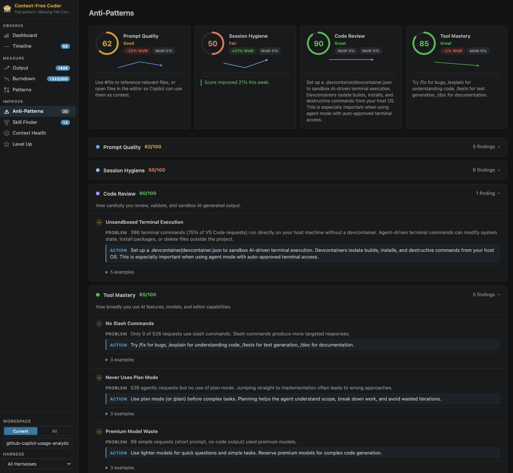</p>
<p align="center">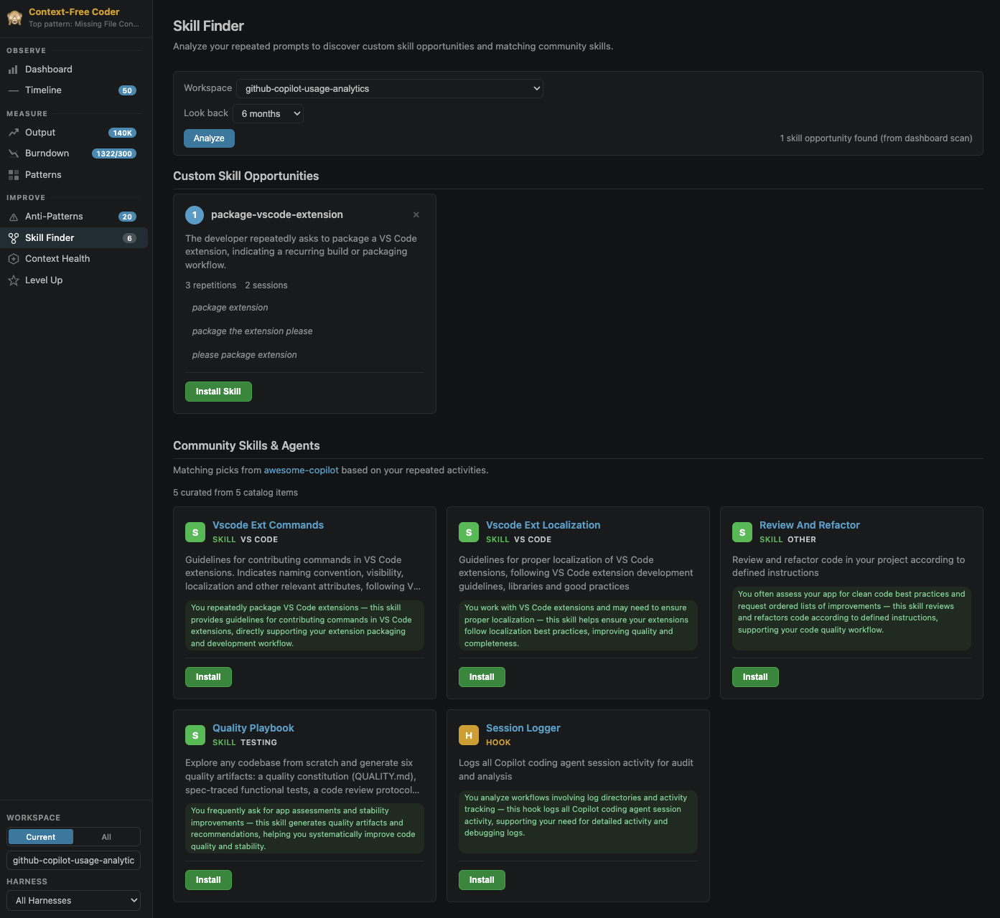</p>
<p align="center">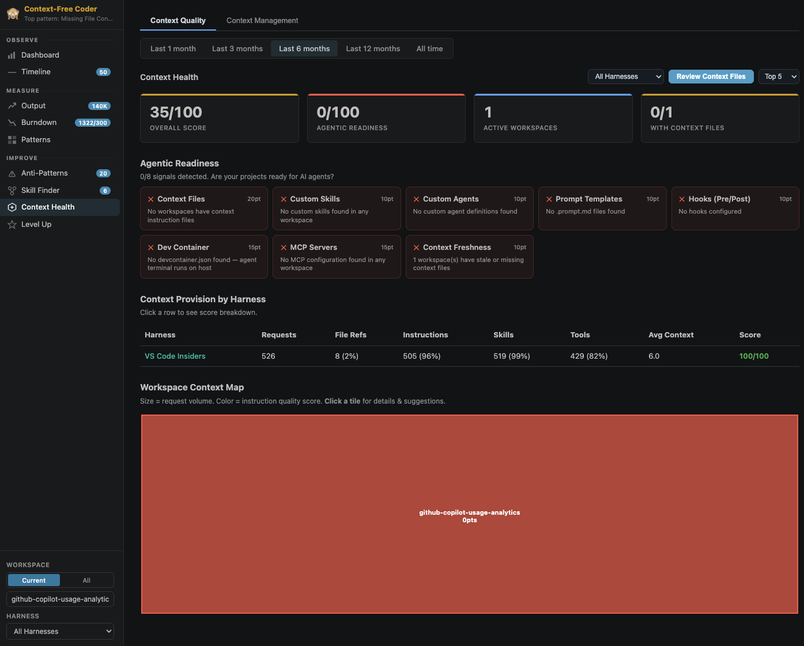</p>
<p align="center">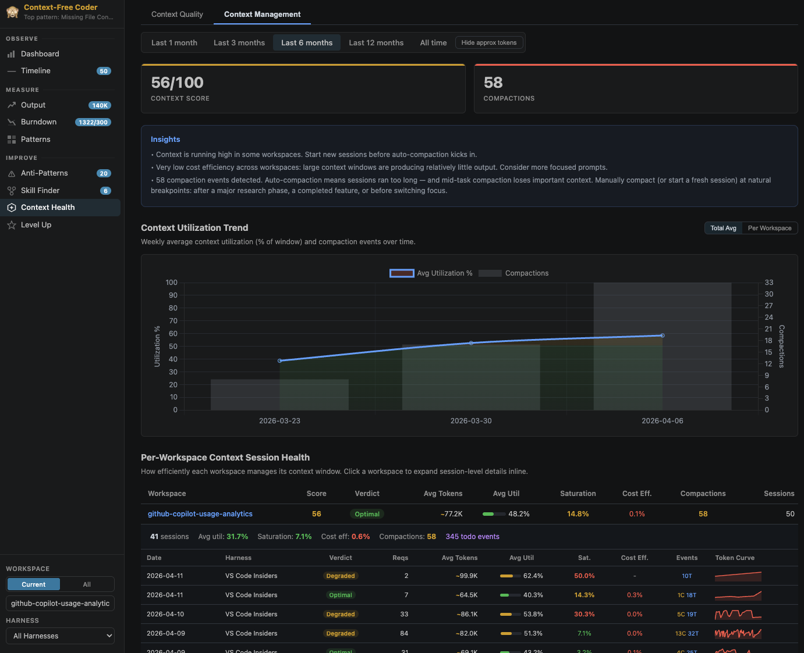</p>
<p align="center">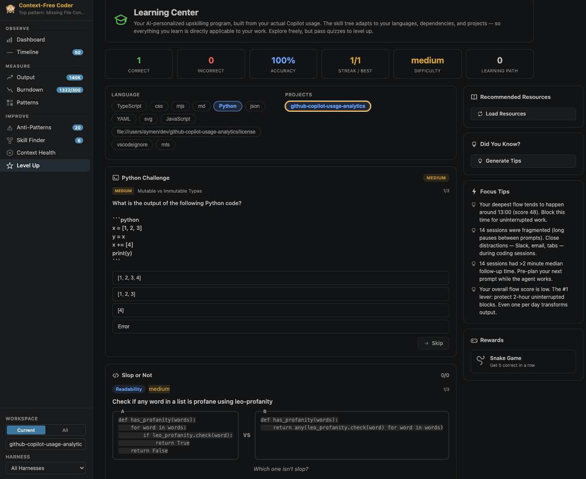</p>
<p align="center">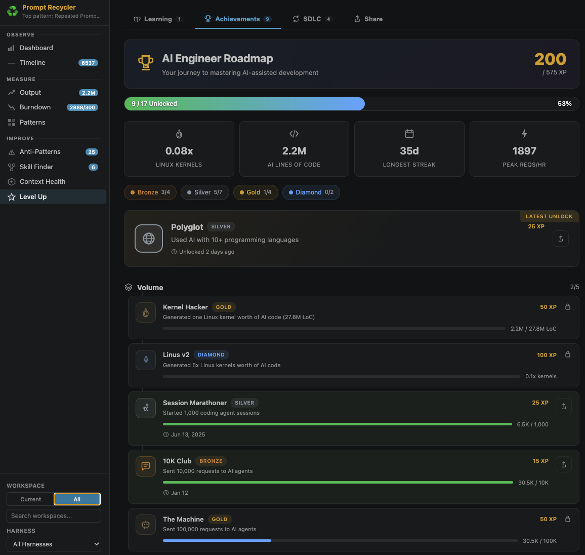</p>
<p align="center">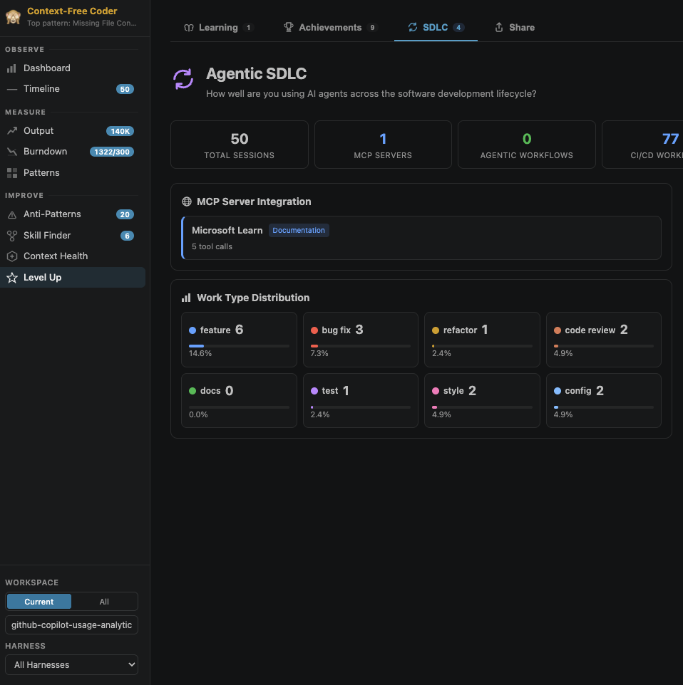</p>
<p align="center">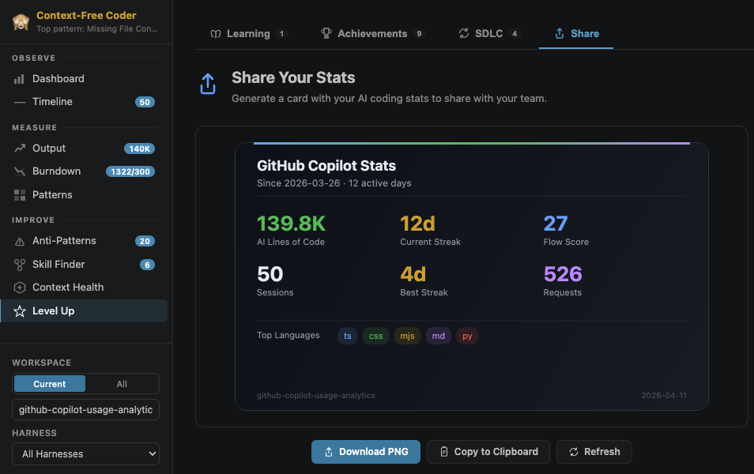</p>
</details>

---

## Installation

Choose one of these paths.

### Path 1 -- Prebuilt VSIX (easiest)

Prerequisites:

- VS Code
- Access to the repository Releases page

Steps:

1. Download the latest `ai-engineer-coach-*.vsix` from Releases.
2. Install it in VS Code:

**macOS / Linux**

```bash
code --install-extension ai-engineer-coach-*.vsix
```

**Windows / PowerShell**

```powershell
code --install-extension (Get-ChildItem . -Filter 'ai-engineer-coach-*.vsix' | Select-Object -First 1).FullName
```

### Path 2 -- Dev Container build (no local Node.js/npm)

Prerequisites:

- VS Code
- Dev Containers extension
- Docker or Podman

Steps:

1. Clone the repo and open it in VS Code.
2. Reopen in container.
3. Run:

```bash
npm ci
npm run package
```

4. Install the generated `.vsix` using one of the commands above.

### Path 3 -- Local build

Prerequisites:

- VS Code
- Node.js and npm

Steps:

```bash
git clone https://github.com/microsoft/ai-engineering-coach.git
cd ai-engineering-coach
npm ci
npm run package
```

Then install the generated `.vsix` using one of the commands above.

### Release permissions and contribution path

If you do not have permission to publish a Release artifact, open a PR with your changes and ask a maintainer to publish the `.vsix` in Releases.

After install:

1. Open the command palette (`Cmd+Shift+P` / `Ctrl+Shift+P`)
2. Run **AI Engineer Coach: Open Dashboard**
3. Navigate pages from the sidebar, filter by workspace or harness

---

## Pages

### Understand

<sub>Personal-fork features — not part of upstream <a href="https://github.com/microsoft/AI-Engineering-Coach">microsoft/AI-Engineering-Coach</a>. See <a href="#credits--attribution">Credits &amp; Attribution</a>.</sub>

| Page       | Description                                                                                                                                                                                                                                                  |
| ---------- | ------------------------------------------------------------------------------------------------------------------------------------------------------------------------------------------------------------------------------------------------------------ |
| **Atlas**  | An Archify-generated, source-backed architecture map of the current workspace, rendered inside VS Code. Shows a scope estimate before every run (you click _Generate_), streams progress, flags maps that are _N commits behind_, and exports a standalone HTML on request. Nothing is written into the repository unless you export |
| **Replay** | Read-only AI edit history. Right-click any file → **Show AI History for File** to see every session and prompt that touched it; expand a row to see that edit's diff, read lazily from the session log. Open the session to see diffs under each turn, or export the transcript + diffs as Markdown |

**Atlas needs:** the `claude` CLI (≥ 2), the Archify skill (`npx skills add tt-a1i/archify -g`, Node ≥ 22.2) and a Chrome/Chromium/Edge install for Archify's final render check. The page shows a matching card with an _Install_ button when something is missing. **Replay needs nothing** — it only reads `~/.claude/projects`; Codex and OpenCode sessions are listed too, without diffs.

| Setting                               | Default  | Description                                                                 |
| ------------------------------------- | -------- | --------------------------------------------------------------------------- |
| `aiEngineerCoach.atlas.enabled`       | `true`   | Show Atlas (greyed in the nav when off)                                     |
| `aiEngineerCoach.atlas.model`         | `""`     | `--model` for Atlas runs; `sonnet` mapped this repo for ~$0.50 vs ~$2 on opus |
| `aiEngineerCoach.atlas.timeoutMs`     | `600000` | Kill a run after 10 minutes                                                 |
| `aiEngineerCoach.atlas.maxMaps`       | `10`     | Maps kept per workspace                                                     |
| `aiEngineerCoach.atlas.refineEnabled` | `false`  | Experimental: free-text refinement + Replay → Atlas overlays                |
| `aiEngineerCoach.replay.enabled`      | `true`   | Show Replay and the context-menu command                                    |
| `aiEngineerCoach.replay.maxDiffBytes` | `524288` | Largest edit payload rendered inline                                        |

### Observe

| Page               | Description                                                                           |
| ------------------ | ------------------------------------------------------------------------------------- |
| **Dashboard**      | Practice scores with week-over-week trends, daily activity chart, top workspace stats |
| **Timeline**       | Gantt-style session timeline with per-day drill-down and overlap detection            |
| **Coding Moments** | Screenshot gallery from AI coding sessions with story reels and workspace filtering   |

### Measure

| Page         | Description                                                                                 |
| ------------ | ------------------------------------------------------------------------------------------- |
| **Output**   | Generated code volume by language, model usage table _(token breakdown temporarily hidden)_ |
| **Burndown** | Monthly AI token budget progress with projections _(temporarily disabled)_                  |
| **Patterns** | 7×24 activity heatmap and work-life balance signals                                         |

### Improve

| Page                | Description                                                                                                                                |
| ------------------- | ------------------------------------------------------------------------------------------------------------------------------------------ |
| **Anti-Patterns**   | Five practice score cards with severity ratings, concrete actions, and example prompts. 45 editable markdown rules plus a coverage heatmap |
| **Rule Editor**     | Create, edit, and tune detection rules visually or as raw markdown. Live-test against your data                                            |
| **Rule Playground** | Interactive REPL for the rule DSL with field browser, function catalog, and metric list                                                    |
| **Data Explorer**   | Browse session fields, view distributions, run ad-hoc filters                                                                              |
| **Skill Finder**    | Discover repeated prompt patterns and matching community skills from the open-source catalog                                               |
| **Context Health**  | Overall context score, agentic readiness checklist, workspace context map, AI-powered instruction-file review                              |

### Level Up

| Page                | Description                                                                      |
| ------------------- | -------------------------------------------------------------------------------- |
| **Learning Center** | Personalized quizzes and code-comparison rounds generated from your actual usage |
| **Achievements**    | XP-based progression with Bronze → Silver → Gold → Diamond tiers                 |
| **Agentic SDLC**    | How you use AI across the full software-development lifecycle                    |
| **Share**           | Generate a shareable stat card and export Markdown/JSON summaries               |

---

## Session Chat (Session Continuation)

<sub>A personal-fork feature, like Prompt Studio — not part of upstream <a href="https://github.com/microsoft/AI-Engineering-Coach">microsoft/AI-Engineering-Coach</a>. See <a href="#credits--attribution">Credits &amp; Attribution</a>.</sub>

Continue any locally stored Claude Code session directly from the dashboard: pick a session, type a message, and Claude's reply is appended to the same `~/.claude` session history — so all existing analytics keep seeing the full conversation.

**Shown by default since 2.0, but inert until you opt in.** Nothing spawns the `claude` CLI until you accept the one-time **Claude-powered features** consent card (shared with Atlas and Prompt Studio's _Improve_). When used:

- It writes **only** to your local `~/.claude` session history, and only via the official `claude` CLI (`claude -p --resume`)
- Each turn spends your Claude usage (API credits or subscription quota)
- Telemetry posture is unchanged — still zero

Hide it with the `aiEngineerCoach.sessionChat.enabled` setting. While on, a **Sessions** tree view appears in the sidebar (Claude sessions grouped by project, newest first — click one to continue it in the dashboard), and the **Session Chat** page offers a fork toggle ("Continue as branch") to branch into a new session instead of appending to the original.

| Setting                                 | Default     | Description                                          |
| --------------------------------------- | ----------- | ---------------------------------------------------- |
| `aiEngineerCoach.sessionChat.enabled`   | `true`      | Kill-switch for the feature (consent still required) |
| `aiEngineerCoach.sessionChat.binPath`   | `"claude"`  | Path to the Claude Code CLI                          |
| `aiEngineerCoach.sessionChat.timeoutMs` | `120000`    | Per-turn timeout in milliseconds                     |
| `aiEngineerCoach.sessionChat.model`     | `""`        | Model override; empty inherits your CLI configuration |

---

## Privacy

- **Read-only until you opt in to Claude-powered features. Zero telemetry.** The extension never modifies your session files or your repository. Session Chat, Atlas and Prompt Studio's _Improve_ spawn the official `claude` CLI only after you accept a one-time consent card; Session Chat appends to `~/.claude` session history, Atlas writes generated HTML to extension storage (never the repo unless you _Export_), Replay writes nothing except an explicit _Export Markdown_
- **Local analysis** — all parsing and analytics run entirely on your machine
- **No proprietary telemetry** — the extension does not phone home or collect usage data
- **Optional AI features** — some features (rule compiler, skill finder, context review) use the VS Code built-in Copilot language model API when explicitly invoked by the user; Session Chat, Atlas and Prompt Studio Improve use your Claude Code CLI account and spend your Claude usage

---

## Code of Conduct

This project has adopted the [Microsoft Open Source Code of Conduct](https://opensource.microsoft.com/codeofconduct/).
For more information see the [Code of Conduct FAQ](https://opensource.microsoft.com/codeofconduct/faq/) or
contact [opencode@microsoft.com](mailto:opencode@microsoft.com) with any additional questions or comments.

## Trademarks

This project may contain trademarks or logos for projects, products, or services. Authorized use of Microsoft
trademarks or logos is subject to and must follow
[Microsoft's Trademark & Brand Guidelines](https://www.microsoft.com/en-us/legal/intellectualproperty/trademarks/usage/general).
Use of Microsoft trademarks or logos in modified versions of this project must not cause confusion or imply Microsoft sponsorship.
Any use of third-party trademarks or logos are subject to those third-party's policies.

## Credits & Attribution

This repository is a personal fork/clone of the original **[AI Engineer Coach](https://github.com/microsoft/AI-Engineering-Coach)** project created and maintained by Microsoft and its open-source contributors.

- **Original project:** https://github.com/microsoft/AI-Engineering-Coach
- **Original authors:** Microsoft Corporation and contributors
- **License:** MIT — Copyright (c) Microsoft Corporation (see [LICENSE](LICENSE))

All credit for the original design, architecture, and implementation belongs to the upstream authors. This fork contains personal modifications and experiments (Understand → Atlas and Replay, Prompt Studio, Session Chat) and is **not** affiliated with, sponsored by, or endorsed by Microsoft.

Atlas maps are produced by **[Archify](https://github.com/tt-a1i/archify)** (MIT, © tt-a1i), an agent skill that turns repository evidence into validated, standalone HTML diagrams. Atlas only orchestrates the skill through your own `claude` CLI; the rendering, validation and viewer are Archify's.

## License

[MIT](LICENSE) — the original MIT License and Copyright (c) Microsoft Corporation are retained in full.

## Disclaimer

This project is an open-source community effort by Microsoft employees. It is **not** an official Microsoft product and is not part of any Microsoft service or support offering. It is provided as-is with no warranties or guarantees.
